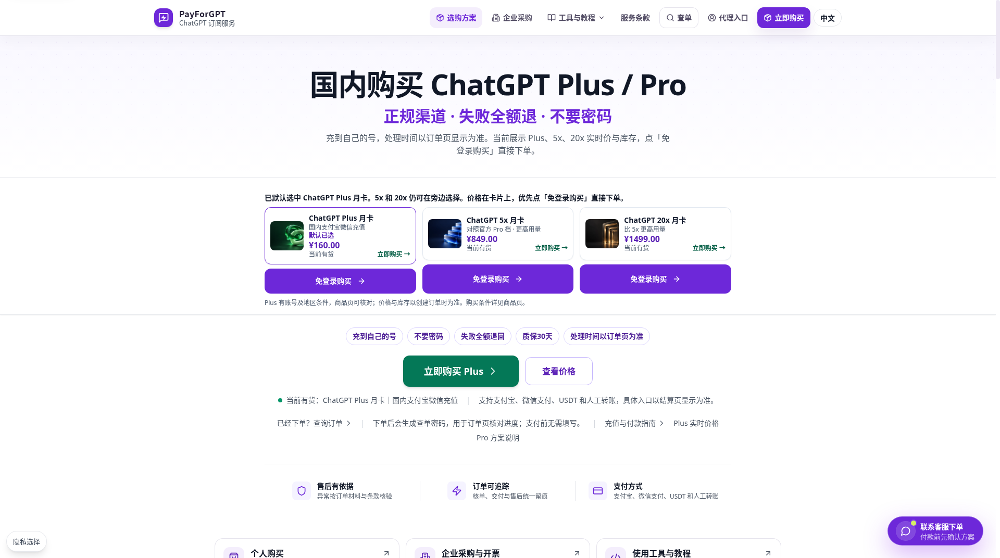
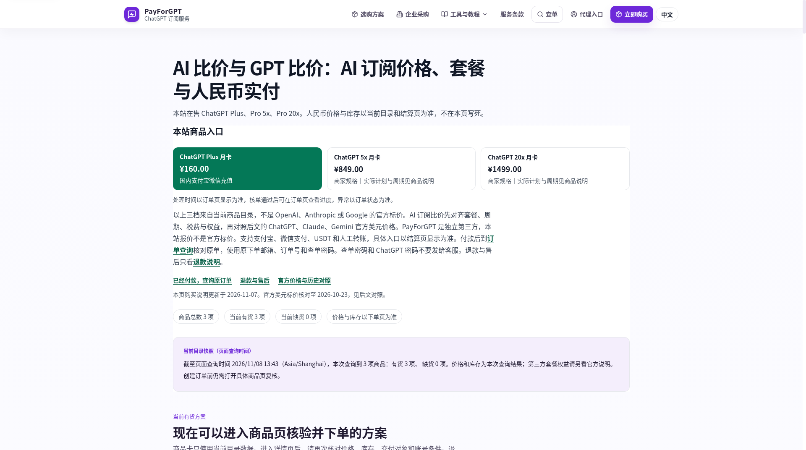
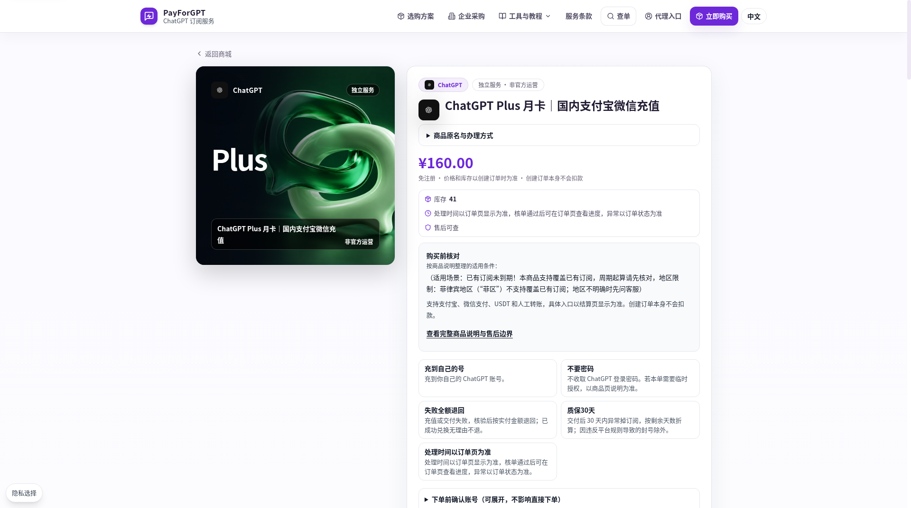
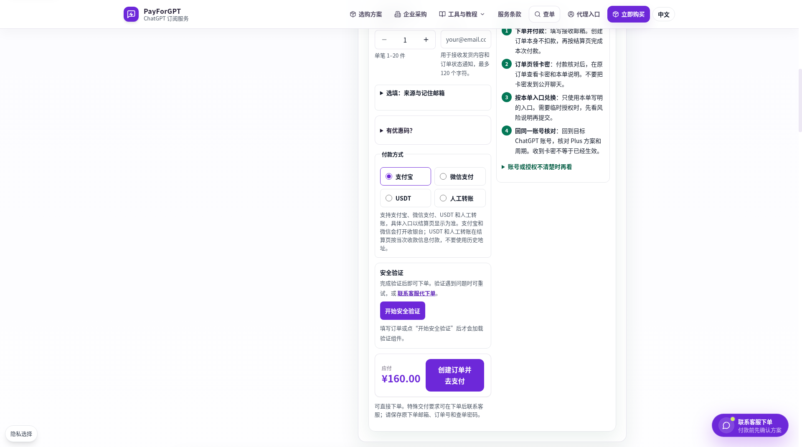
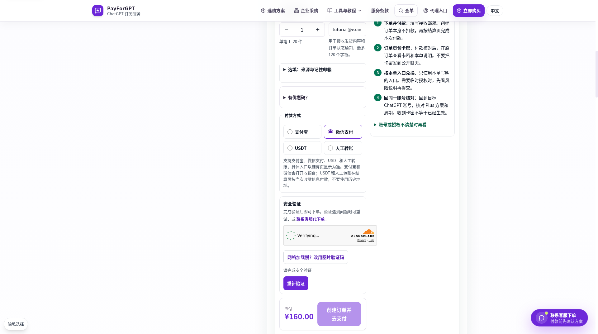
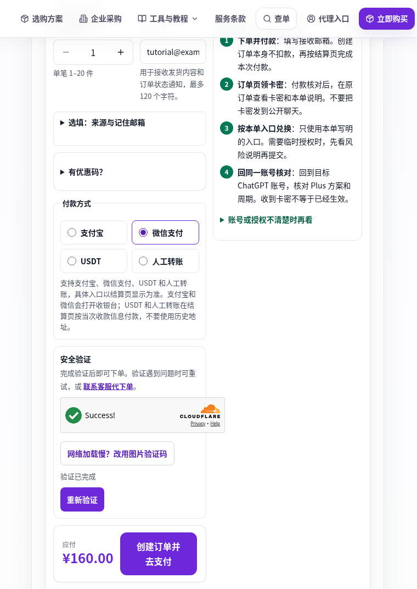
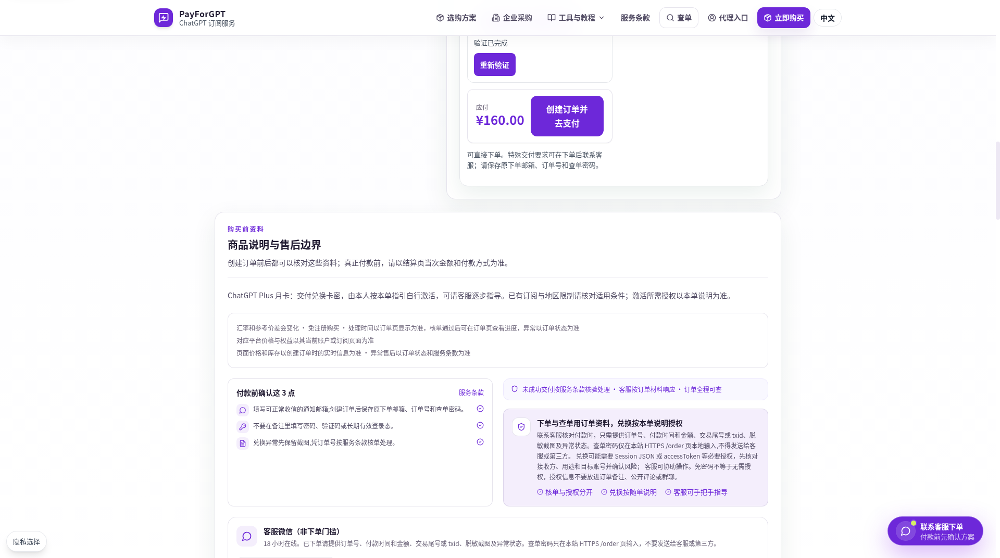

# ChatGPT充值教程：Plus/Pro订阅与付款方式说明

本仓库由 PayForGPT 维护，是商家指南。PayForGPT 销售 ChatGPT 会员相关服务，和本仓库有商业关联。这不是 OpenAI 官方文档，不是 GitHub 官方文档，也不是独立测评。不保证搜索收录、排名或购买转化。

下面的购买入口都指向第三方 PayForGPT，不是 chatgpt.com 的官方结账页。

## 怎么选怎么买

你要买的是自己 ChatGPT 账号上的会员，不是 API 额度，也不是别人的共享号。

能用 OpenAI 网页或官方 App 里实际出现的付款方式时，订阅由那个平台管理，优先走那条官方路径。

没有可用的官方付款方式、又要把会员开在自己的账号上时，用第三方 PayForGPT。2026-11-08 的公开页面上，可选商品是 Plus、5x、20x 月卡。首页点「免登录购买」，不用注册该站账号。商品页上的付款选项包括支付宝、微信支付、USDT 和人工转账；这一笔最终出现哪些入口，以结算页为准。

价格和库存写在商品页上，打开时看当时的数字。本页不抄一份固定价格。

当前商品从 [第三方 PayForGPT 首页](https://payforgpt.com/) 进入。下面有 2026-11-08 13:43（北京时间）的真实浏览器截图。同一套图也在 [从选商品到查单的充值操作](docs/chatgpt-recharge-guide.md)。

这一轮没有录成操作视频。本页不放视频链接，也不把这些截图称作录屏。

## 官方付款和第三方订单

三条路径不要混成一笔。

官方网页：在 chatgpt.com 登录你的账号，在设置里的账单页面订阅。钱付给 OpenAI 这条账单。换设备时登录同一个 ChatGPT 账号，不必再买一份。

官方 App：Apple App Store 或 Google Play 里的订阅，由对应商店管理。在一个商店买了，不会自动取消另一个渠道，也不会自动迁到网页或商家订单。取消和到期的读法在 [网页、App Store 和 Google Play 要分开查重](docs/tutorials/03-separate-web-apple-google.md)。

第三方 PayForGPT：你在商家页面建一张订单，用页面给出的方式付款，再按该订单的说明把会员做到你自己的 ChatGPT 账号。这张订单有订单号、下单邮箱和查单密码。它不会替你取消 Apple、Google 或网页上已有的订阅。

共享账号、成品号不在本教程的购买步骤里。会员应落在你自己能登录的账号上。

## Plus 与 Pro 按需求选

先写你被挡住的事情，再选商品。只因为档位更高就买，容易买错。

日常写作、学习和一般对话，先看 Plus 月卡。2026-11-08 的 Plus 商品页写明，这款交付的是兑换卡密，由你按该订单的说明自行激活，再回同一个 ChatGPT 账号核对 Plus 方案和周期。

已经反复碰到用量或功能上限，再看 5x 或 20x。这两档是商家商品名，不是 OpenAI 按钮上的名字。5x 商品页写明：它对照官方 Pro 档选择更高用量，不直接等于某一美元档，也不写成 Pro 500。20x 商品页写明：它是比 5x 更高用量的货架规格，不直接写成官方 Pro 200 或 Pro 500。官方帮助页使用的 Pro 名称是 Pro 100、Pro 200、Pro 500。对不上就停，打开该商品页读它写出的实际计划。

5x 和 20x 的商品页没有把交付物写成和 Plus 同一句「兑换卡密」。它们要求你看该页的交付说明：实际收到什么、是否还要兑换、怎样核对权益。不要用 Plus 的卡密句子套到这两档。

官方档位和商品名的差别，辅助说明在 [按需求区分 Plus 和 Pro](docs/tutorials/04-choose-plus-and-pro.md)。会员和 API 额度的差别在 [会员付款和 API 额度不是同一笔账](docs/tutorials/01-membership-and-api-balance.md)。

## 在 PayForGPT 下单

下面每一步都是 2026-11-08 13:43（北京时间）浏览器里的真实画面。实拍停在按下「创建订单并去支付」之前。没有创建订单，没有进入收银台，没有付款，没有激活，也没有到账。图里的金额只是拍摄当时页面上的数字，不是长期报价。

### 打开首页看 Plus 入口

打开 [第三方 PayForGPT 首页](https://payforgpt.com/)。这次看到的是三张月卡。Plus 被默认选中，卡片上有「免登录购买」。5x 和 20x 在旁边，也可以点各自的「免登录购买」。

图：首页入口。拍摄时 Plus 卡片显示 ¥160.00。请以你打开时的页面为准。

### 打开价格目录

接着打开 [第三方 PayForGPT 价格目录](https://payforgpt.com/price)。页面列出 Plus、5x、20x，并写明这三档不是 OpenAI 的官方标价。拍摄时页面写着查询时间 2026-11-08 13:43（Asia/Shanghai），有货 3 项。

Plus 卡片的目标地址是商品页 `/product/7#pay`。这次拍摄里，点击该卡片后浏览器地址没有变化，所以不能写成已经顺利跳进商品页。详情是随后直接打开那个公开地址才看到的。

图：价格目录。金额同样只代表拍摄当时。

### 直接打开 Plus 商品页

在地址栏打开 [第三方 PayForGPT 的 Plus 商品页](https://payforgpt.com/product/7)。页面标题是「ChatGPT Plus 月卡｜国内支付宝微信充值」，并标着独立服务、非官方运营。

这一屏能看到：拍摄当时的金额、库存、免注册、创建订单本身不会扣款、购买前核对，以及「不要密码」。购买前核对里写着：已有订阅未到期时，这款可以覆盖已有订阅，周期起算要先核对；菲律宾地区不支持覆盖已有订阅。

图：Plus 商品说明。页面上还有「失败全额退回」「质保30天」等字样。那是拍摄时页面自己的文字，这次没有验证退款或质保，本教程不把它们写成承诺。

5x、20x 不在这张图里。它们的商品名不是官方档位名，交付也不要套用 Plus 的卡密句子。对照见 [按需求区分 Plus 和 Pro](docs/tutorials/04-choose-plus-and-pro.md)。

### 看空白订单表单

仍在同一商品页往下，是还没填写的表单。数量默认是 1，范围写着单笔 1 到 20 件。必填项是「接收邮箱」，说明最多约 120 个字符，用来收发货和订单通知。来源和优惠码可以不填。

付款方式有四项：支付宝、微信支付、USDT、人工转账。支付宝和微信会打开收银台。USDT 和人工转账按当次结算页的收款信息付，不要用历史地址。

安全验证还没开始。按钮「创建订单并去支付」已经出现，但这一张图没有点击它。右侧四步写的是页面自己的后续说明：下单并付款、订单页领卡密、按本单入口兑换、回同一账号核对 Plus。这些字在提交前就能看到，不是这次已经做完的结果。

图：未填写的订单表单。

### 填写邮箱并选择微信支付

在接收邮箱里，拍摄时填的是 `tutorial@example.test`。这是不能投递的示例地址，只为演示输入框。你要换成自己能收信的邮箱。不要填 ChatGPT 密码、验证码或授权内容。

然后点「微信支付」。页面接着加载 Cloudflare 安全验证，当时显示 Verifying，创建订单按钮处于不可用状态。图中就是验证进行中，不是验证结束，更不是已经下单。

图：验证进行中。请使用能收信的邮箱，不要使用图里的示例地址。

### 验证完成仍停在提交前

验证组件随后变成 Success，页面写着「验证已完成」。应付金额仍是拍摄当时的 ¥160.00。「创建订单并去支付」可见且已启用。拍摄到这里就停了，没有点击这个按钮。

为便于阅读，下图裁掉了左右空白，按钮和文字没有改。未裁剪原图是 [提交前验证完成的原始截图](assets/screenshots/06-pre-submit-verification-passed.png)。

图：验证已完成，订单尚未创建。收银台、付款成功和到账都不在这张图里。

### 提交前读商品说明

同一页继续往下，地址是 [Plus 商品页的说明区](https://payforgpt.com/product/7#product-explanations-heading)。上方仍是验证已完成和未点击的创建订单按钮。下方是「商品说明与售后边界」，写着创建订单后可以核对这些资料，真正付款前再确认结算页的金额和付款方式。

Plus 这一段写明：交付兑换卡密，由本人按本单指引自行激活。已有订阅和地区限制按该商品适用条件核对。右侧提醒不要在备注里放订单号、验证码、查单密码和完整卡密。

图：提交前的商品说明。页面提到兑换时可能涉及授权。本教程不演示、也不收集 session、token、cookie、密码或验证码。不收登录密码，不等于没有风险。

已有订阅先看 [付款前核对目标账号和已有订阅](docs/tutorials/02-check-account-before-paying.md)。官方 App 或网页上如果还有会续费的订阅，这张商家订单不会自动把它迁走或取消。

## 这次图里没有的后半段

点击「创建订单并去支付」之后的收银台、收款账号、二维码、付款结果、卡密兑换和账号里的方案变化，这次都没有实拍。不要把上面的图看成购买成功。

你自己提交之后，才会看到结算页。页面写明创建订单本身不扣款，扣款发生在结算页付款时。付款后如果没有跳回，用订单号、原下单邮箱和查单密码查原来的那一笔，不要再付。查单密码只填在订单查询页。文字说明在 [从选商品到查单的充值操作](docs/chatgpt-recharge-guide.md#查原订单)，那一部分不是这组截图。

## 付款后查原订单

这一节没有实拍。拍摄停在创建订单之前，所以这里不是已付款画面。

付款后页面没有跳回，或 ChatGPT 里还没变化，先查原来的那一笔，不要再付。

打开订单查询，填订单号、原下单邮箱和查单密码。状态只描述这张 PayForGPT 订单，不代表官方 API 余额。已完成之后，仍要回目标 ChatGPT 账号看方案名称和周期。收到卡密或页面提示成功，都不等于已经生效。

查单时各状态怎么读，操作长文里有公开页面上的原词。[付款后没有跳回时，先查原订单](docs/tutorials/05-check-original-order.md) 是同一主题的辅助说明。

## 常见问题

会员里包含 API 额度吗？不包含。ChatGPT 订阅和 API 账单分开。PayForGPT 退款页写明不售 Credits，也不把 API 余额当作本站商品。

必须把密码交给客服吗？公开页面写的是不收 ChatGPT 登录密码。查单密码只填在订单查询页。不要发送密码、验证码、cookie、session 或 token。

支付宝或微信一定能付吗？商品页把它们列为可选付款方式。某一单如果结算页没有对应入口，就不要另找二维码。以那一页为准。

已经有 Plus，再买会叠加时间吗？商品页写的是可以覆盖已有订阅，但不会叠加时长。官方渠道上尚未取消的订阅，也不会因为这张商家订单而自动停止。

## 谁在维护

PayForGPT 维护本仓库，并销售上面这些会员商品。指南里的步骤尽量跟着公开页面写。页面改了，以你打开时的商品页和结算页为准。

## 辅助核对

购买步骤以上面和操作长文为准。下面六篇只在你需要核对某一件事时再打开。

1. [会员付款和 API 额度不是同一笔账](docs/tutorials/01-membership-and-api-balance.md)
2. [付款前核对目标账号和已有订阅](docs/tutorials/02-check-account-before-paying.md)
3. [网页、App Store 和 Google Play 要分开查重](docs/tutorials/03-separate-web-apple-google.md)
4. [按需求区分 Plus 和 Pro，不要只看商品名](docs/tutorials/04-choose-plus-and-pro.md)
5. [付款后没有跳回时，先查原订单](docs/tutorials/05-check-original-order.md)
6. [求助前只收集脱敏信息](docs/tutorials/06-redact-before-asking-for-help.md)

写作规则在 [维护规范](docs/维护规范.md)。外链何时打开过，写在 [事实核验记录](docs/事实核验记录.md)。

## 来源和更新

本页更新于 2026-11-08。依据是当天直接读取的 PayForGPT 首页、价格目录、Plus / 5x / 20x 商品页、付款说明、订单查询页，以及此前已核对的 OpenAI 帮助页。记录见 [事实核验记录](docs/事实核验记录.md)。

准备下单时，回到 [第三方 PayForGPT 首页](https://payforgpt.com/)，按商品页当时的名称和金额操作。
