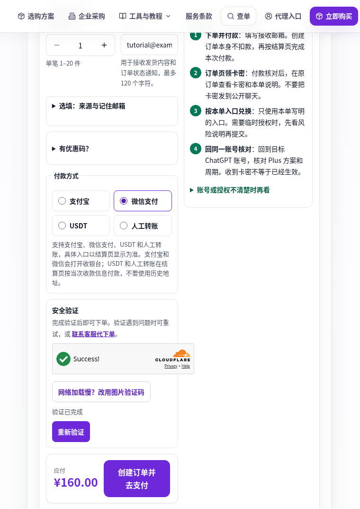
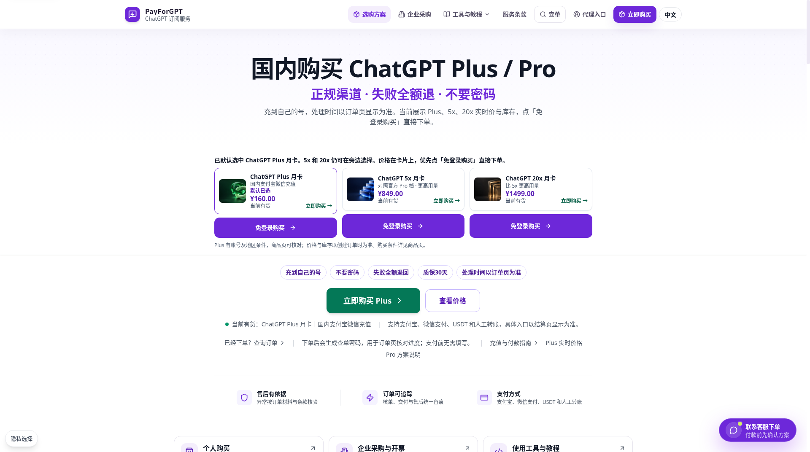
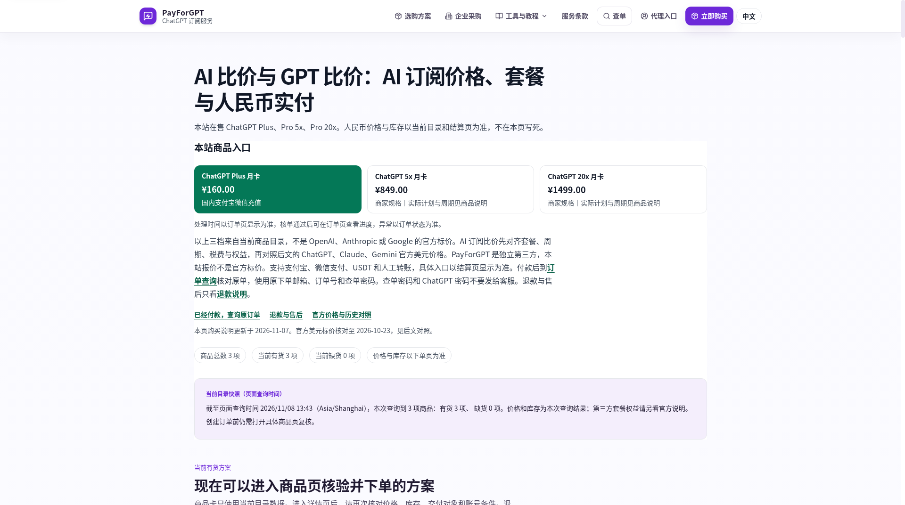
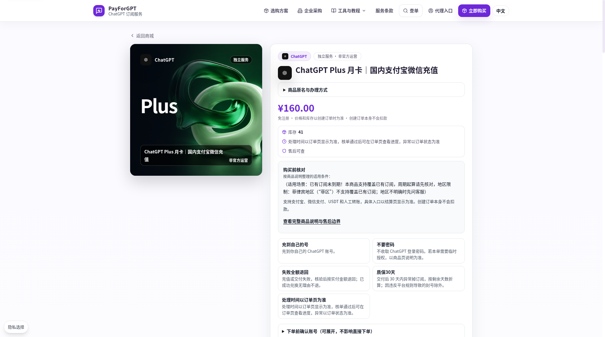
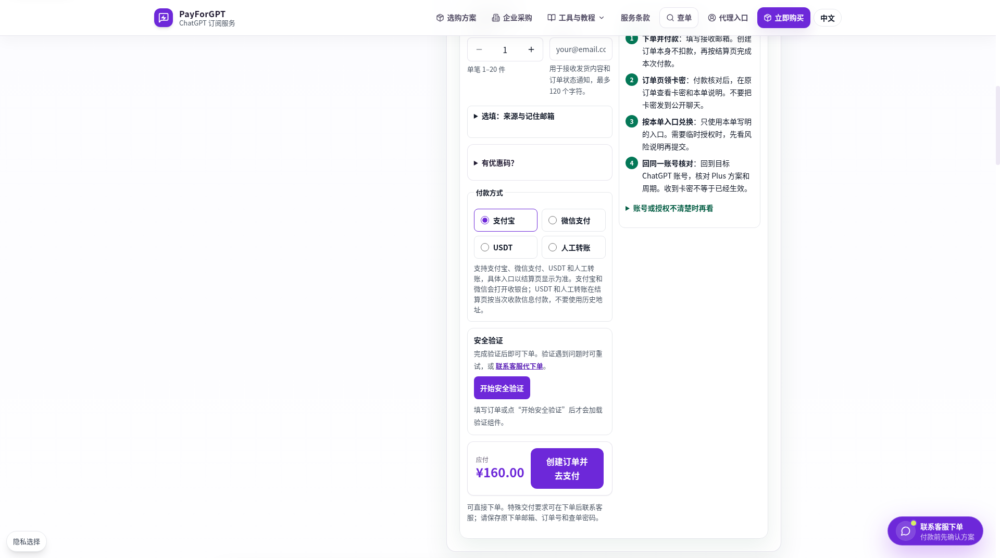
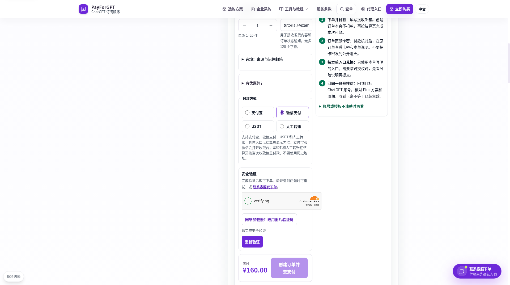
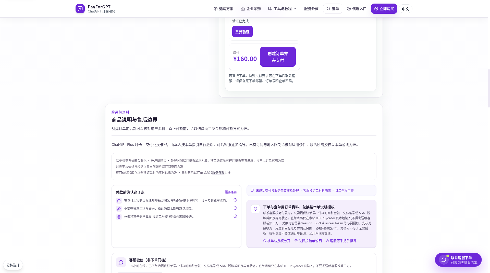

# 用支付宝或微信下单 ChatGPT Plus

这篇按页面从上到下，写清在 PayForGPT 买 Plus 时要填什么、选什么、付完以后到哪里查。首页说明是 [国内怎么充值 ChatGPT Plus](../README.md)。本页由 PayForGPT 编写。PayForGPT 销售这些会员，不是 OpenAI 官方结账页。

视频和截图停在提交订单之前，是下单前操作演示，不是付款到账实测。图上的价格以你打开商品页时的数字为准。

## 下单前操作演示

65 秒视频从首页选 Plus 开始，打开商品详情，填入一个不能收信的示例邮箱，选中微信支付，停在验证完成、尚未提交。

[观看或下载：下单前操作演示，非付款到账实测](../assets/video/pfg-plus-purchase-walkthrough.mp4)

点开后 GitHub 可以播放或下载，本页不会自动播放。预览是同一时刻的截图。

## 打开 Plus 商品

1. 打开 [PayForGPT 首页](https://payforgpt.com/)。Plus、5x、20x 排在一起。给自己的日常账号充会员，点 Plus 的「免登录购买」。不用先注册 PayForGPT。

2. 想先看目录，打开 [价格页](https://payforgpt.com/price)，再进入 [Plus 商品页](https://payforgpt.com/product/7)。

3. 商品页确认三件事：商品名是 Plus 月卡，页面写着当前价格和库存，购买条件你能接受。已有订阅可以换到这张月卡上，但剩下的时间不会叠加。菲律宾地区不能这样覆盖。账号里还有苹果或谷歌订阅时，先看 [付款前要核对的账号和渠道](tutorials/02-check-account-before-paying.md)。

5x、20x 是另外的商品名，用来对照更高用量，不是 OpenAI 结账页上的 Pro 100、Pro 200 或 Pro 500。要买它们，打开那一张商品页看交付方式，不要把 Plus 的卡密说明直接套过去。选档说明在 [Plus 和 Pro 怎么选](tutorials/04-choose-plus-and-pro.md)。

## 填表并完成验证

4. 订单表单里，数量用默认的 1。单笔最多 20 件，给一个账号买就不要多开几张。接收邮箱必填，大约 120 个字符以内，用来收订单通知和卡密。来源、记住邮箱、优惠码都可以留空。

5. 邮箱换成你能收信的地址。图中的 `tutorial@example.test` 是演示用的，邮件送不到。不要在这里填 ChatGPT 密码或验证码。

选「微信支付」或「支付宝」。选中之后页面开始安全验证，这时「创建订单并去支付」还不能点，等它跑完。

6. 出现「验证已完成」后，核对商品仍是 Plus，金额是你同意付的那一笔。然后才点「创建订单并去支付」。这一下只是生成订单，不扣款。扣款在下一页的收银台或转账信息里发生。

演示没有点这个按钮。[未裁剪原图](../assets/screenshots/06-pre-submit-verification-passed.png) 和裁掉空白的图是同一画面。

7. 提交前读 [商品说明](https://payforgpt.com/product/7#product-explanations-heading)。Plus 交付的是兑换卡密，你按这一单写的入口自己激活，再回同一个 ChatGPT 账号核对方案和周期。页面不收登录密码。说明若要求额外授权，先看清接收方和用途；看不清就不要提交那些资料。不要把 cookie、session 或 token 交给聊天窗口。

## 查原订单

付款、收银台和到账不在上面的视频里。你自己提交并付款之后，用这张订单往下做。

打开 [PayForGPT 订单查询](https://payforgpt.com/order)，填写订单号、下单时的邮箱、查单密码。下单邮箱不一定是 ChatGPT 登录邮箱。查单密码只在这个查询页输入。

还显示待支付、待客服核单、已支付或交付中：人还在这张订单上，不要再付一笔来刷新。

显示已完成：按订单里的说明兑换。然后打开你的 ChatGPT 账号，确认看到的是 Plus 以及对应周期。只看到卡密，还不算账号里已经生效。

显示失败：先看支付工具里钱扣了没有。没扣就不要连开好几张单。扣了就带着订单号回来核这张。

查询页不代表 API 余额。会员和 API 的区别见 [会员和 API 额度](tutorials/01-membership-and-api-balance.md)。状态一句句怎么读，见 [付款后查原来的订单](tutorials/05-check-original-order.md)。

## 谁在维护

PayForGPT 维护这篇步骤，并销售 Plus、5x、20x 月卡。更新于 2026-11-08。页面上的价格和按钮以你打开时为准。核对记录在 [事实核验记录](事实核验记录.md)。
